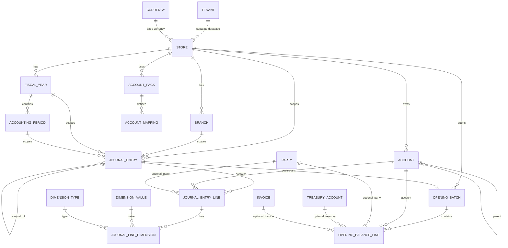
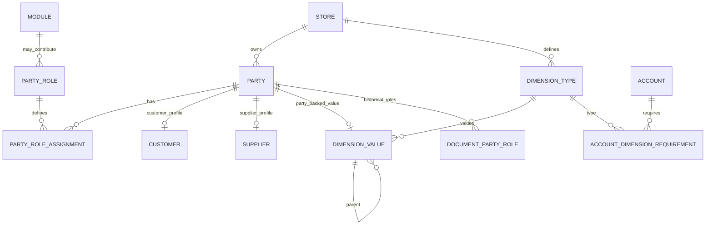
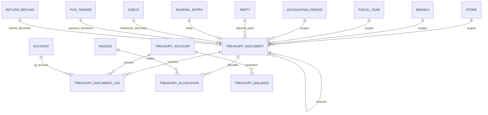
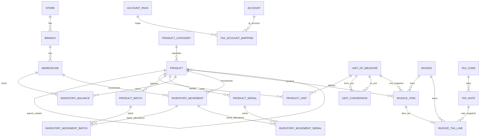
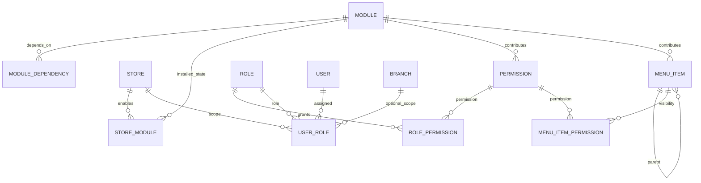

# مدل دامنه و ERD هدف MVP پایهٔ حسابداری

تسک: `P0-01`
تاریخ: ۲۰۲۶-۱۱-۲۸
وضعیت: نهایی‌شده برای تأیید
خروجی بعدی: `P0-02` — Coding، Account Pack و ماتریس ثبت

## ۱. هدف این سند

این سند مدل دادهٔ هدف را پیش از تغییر schema و کدنویسی خزانه‌داری تعیین می‌کند تا موارد زیر بعداً دوباره‌کاری نشوند:

- Coding و ساختار حساب‌ها
- تفصیلی شناور و مرکز هزینه/سود
- نقش‌های قابل توسعهٔ طرف‌حساب
- ارز و ارز پایه
- مدل یکپارچهٔ خزانه، Advance، تخصیص و تهاتر
- مانده‌های اولیه
- موتور ماژول، مجوز و منوی پویا
- واحدهای اندازه‌گیری و گزارش مالیات

این سند مجوز migration یا تغییر کد نیست؛ قرارداد طراحی است.

---

## ۲. اصول طراحی

1. **هسته بدون fork صنفی:** Industry Packها روی core سوار می‌شوند.
2. **بدون hard-code:** کد حساب، نوع سند، نقش، مجوز و منو از داده/قرارداد قابل تنظیم می‌آیند.
3. **اسناد قطعی immutable:** اصلاح فقط با reversal متصل و Auditدار.
4. **GL همیشه متوازن:** ثبت نهایی فقط از `PostingService`.
5. **حرکت وجه یکتا:** تخصیص و تهاتر گردش نقدی تکراری نمی‌سازند.
6. **Party هویت واحد است:** Customer/Supplier و نقش‌های آینده پروفایل همان Party هستند.
7. **ابعاد تحلیلی عمومی:** Party فقط یک Dimension Type است؛ Cost/Profit Center و Project نیز ابعادند.
8. **Snapshot تاریخی:** هویت Party، نرخ ارز، نرخ مالیات، واحد و قیمت در سند نهایی snapshot می‌شوند.
9. **Tenant با دیتابیس جدا:** `tenant_id` به جداول دامنه اضافه نمی‌شود.
10. **Module disable داده را حذف نمی‌کند:** فقط عملیات جدید را متوقف می‌کند.
11. **منو جایگزین Authorization نیست:** مجوز در Gate/Policy و Service کنترل می‌شود.
12. **Print Agent و طراح فاکتور خارج از دامنهٔ MVP هستند.**

---

## ۳. وضعیت فعلی در یک نگاه

| دامنه | وضعیت فعلی | شکاف اصلی |
|---|---|---|
| حساب‌ها | درخت دو سطحی Group/Subsidiary، کد چهاررقمی | Account Pack، mapping و Coding رسمی وجود ندارد |
| اسناد GL | JournalEntry و JournalEntryLine، reversal، Audit و Outbox | Dimension عمومی، ارز و Opening یکپارچه ندارد |
| طرف‌حساب | Party + Customer/Supplier | نقش‌های پویا و snapshot نقش‌ها وجود ندارد |
| خزانه | Receipt/Payment و allocation مستقیم | Advance، تخصیص بعدی، تهاتر، انتقال و هزینه اختصاصی ندارد |
| Opening | GL Opening و InventoryOpening جدا | دو مسیر مستقل و ناسازگار |
| ارز | فقط `stores.currency` | Currency، نرخ تسعیر و مبلغ پایه وجود ندارد |
| واحد | رشتهٔ آزاد `products.unit` | Registry، واحد پایه و تبدیل وجود ندارد |
| مالیات | snapshot نرخ/مبلغ در InvoiceItem | TaxCode/Rate تاریخ‌دار و گزارش مالیات وجود ندارد |
| ماژول | config registry + `store_modules` | provider، lifecycle، permission و menu contribution کامل نیست |
| RBAC | enum `UserRole` و متدهای `can...` | Role/Permission دیتابیسی و Gate/Policy وجود ندارد |
| منو | array ثابت TypeScript | منوی server-side و ماژول‌محور وجود ندارد |

---

# ۴. ERD هدف

## ۴.۱ هستهٔ سازمانی و حسابداری



## ۴.۲ طرف‌حساب، نقش و ابعاد



## ۴.۳ خزانه، تخصیص و تسویه



## ۴.۴ کالا، انبار، واحد و مالیات



## ۴.۵ ماژول، مجوز و منو



---

# ۵. موجودیت‌های جدید و قراردادهای آن‌ها

## ۵.۱ Currency و Exchange Rate

### `currencies`
- `code` یکتا
- `name`
- `symbol`
- `precision`
- `is_active`

### `currency_rates`
- `base_currency_id`
- `quote_currency_id`
- `rate`
- `effective_at`
- `source`
- یکتای `(base_currency_id, quote_currency_id, effective_at)`

### فیلدهای هدف
- `stores.base_currency_id`
- در اسناد تجاری و خزانه: `currency_id`، `exchange_rate_snapshot`، `original_amount`، `base_amount`
- در `journal_entry_lines`: ارز، مبلغ اصلی و مبلغ معادل ارز پایه

قواعد:
- GL همیشه در ارز پایه ثبت می‌شود.
- نرخ تسعیر در زمان سند snapshot می‌شود.
- برای IRR نرخ پایه برابر ۱ است.
- بازارش مجدد ارز و سود/زیان تسعیر پیشرفته خارج از MVP است.

## ۵.۲ Account Pack و Coding

### `account_packs`
- `code`
- `name`
- `version`
- `is_system`
- `is_active`

### `account_mappings`
- `store_id`
- `account_pack_id`
- `mapping_key`
- `account_id`
- یکتای `(store_id, account_pack_id, mapping_key)`

مثال mapping:

```text
cash
bank
accounts_receivable
accounts_payable
customer_advances
supplier_advances
checks_receivable
checks_payable
inventory
cogs
sales
sales_returns
vat_receivable
vat_payable
capital
drawings
misc_expense
other_income
```

قواعد:
- هیچ کد حساب در Serviceها hard-code نمی‌شود.
- Account Pack می‌تواند توسط Profile یا Module contribute شود.
- تغییر Account Pack پس از گردش، فقط با migration/نگاشت رسمی انجام می‌شود.
- Coding نهایی در `P0-02` تعیین می‌شود.

## ۵.۳ Dimension و تفصیلی شناور

### `dimension_types`
- `code`
- `name`
- `source_kind`: `party | store | branch | warehouse | custom`
- `store_id nullable`
- `is_active`

### `dimension_values`
- `dimension_type_id`
- `store_id`
- `code`
- `name`
- `parent_id nullable`
- `party_id nullable`
- `valid_from`
- `valid_to nullable`

### `account_dimension_requirements`
- `account_id`
- `dimension_type_id`
- `required`
- `default_dimension_value_id nullable`

### `journal_entry_line_dimensions`
- `journal_entry_line_id`
- `dimension_type_id`
- `dimension_value_id`
- `value_code_snapshot`
- `value_name_snapshot`
- یکتای `(journal_entry_line_id, dimension_type_id)`

ابعاد اولیهٔ MVP:

```text
party
cost_center
profit_center
project
treasury_account
warehouse
```

قواعد:
- `store_id`, `branch_id`, `fiscal_year_id`, `accounting_period_id` ابعاد ساختاری native باقی می‌مانند.
- `journal_entry_lines.party_id` در فاز مهاجرت dual-write می‌شود.
- Cost Center و Profit Center از همین موتور استفاده می‌کنند، نه ستون‌های جدا.
- ماژول‌ها می‌توانند Dimension Type جدید contribute کنند.

## ۵.۴ Party Roles

### `party_roles`
- `code`
- `name`
- `store_id nullable`
- `module_id nullable`
- `allowed_entity_types`
- `is_system`
- `is_active`

### `party_role_assignments`
- `party_id`
- `party_role_id`
- `store_id`
- `is_active`
- `valid_from`
- `valid_to nullable`
- `profile_json nullable`
- `assigned_by nullable`

### `document_party_roles`
- `document_type`
- `document_id`
- `party_role_id`
- `party_role_snapshot`
- `valid_from`
- `valid_to nullable`

قواعد:
- Customer و Supplier به assignment نقش تبدیل می‌شوند، اما extension tableهای مالی آن‌ها حفظ می‌شوند.
- یک Party می‌تواند چند نقش فعال داشته باشد.
- نقش‌های صنفی از ماژول می‌آیند.
- snapshot سند نهایی باید نقش‌های مؤثر همان زمان را نیز نگه دارد.
- `national_id/tax_id` در فاز بعدی unique/required مشروط به entity type می‌شوند؛ این جزئیات در `P0-03` نهایی می‌شود.

## ۵.۵ Treasury یکپارچه

مدل فعلی Receipt/Payment به یک قرارداد منطقی مشترک منتقل می‌شود؛ migration به‌صورت expand/contract انجام خواهد شد.

### `treasury_documents`
- `store_id`, `branch_id`, `fiscal_year_id`, `accounting_period_id`
- `document_number`
- `document_type`:
  - `receipt`
  - `payment`
  - `advance_receipt`
  - `advance_payment`
  - `transfer`
  - `expense`
  - `other_income`
  - `capital_contribution`
  - `capital_withdrawal`
  - `netting`
  - `opening`
- `purpose`: `invoice_settlement | advance | on_account | non_invoice`
- `party_id nullable`
- `party_snapshot nullable`
- `currency_id`
- `exchange_rate_snapshot`
- `amount`
- `base_amount`
- `status`: `pending | posted | reversed | cancelled`
- `journal_entry_id nullable`
- `idempotency_key`
- `request_hash`
- `reversal_of_id nullable`
- `created_by`, `posted_by`, `posted_at`

### `treasury_document_legs`
- `treasury_document_id`
- `treasury_account_id nullable`
- `gl_account_id`
- `direction`: `debit | credit`
- `amount`
- `base_amount`
- `cashflow_category`: `operating | investing | financing | internal_transfer | non_cash | opening`
- `description`

### `treasury_allocations`
- `treasury_document_id`
- `invoice_id`
- `allocation_kind`: `direct | advance_application | netting`
- `amount`
- `allocation_date`
- `status`: `pending | posted | reversed`
- `journal_entry_id nullable`
- `reversal_of_id nullable`
- `idempotency_key`
- `request_hash`

### `treasury_balances`
- projection قابل بازسازی از GL و Treasury legs
- `treasury_account_id`
- `balance`
- `last_reconciled_at`

قواعد:
- `direct allocation` هنگام صدور Receipt/Payment انجام می‌شود و JE اضافه ندارد.
- `advance application` JE انتقال Advance ↔ AR/AP دارد.
- `netting` هیچ TreasuryAccount یا گردش وجه ندارد.
- `transfer` فقط یک JE دارد و در Cash Flow به‌عنوان internal transfer دسته‌بندی می‌شود.
- Expense/Other Income/Capital از Customer/Supplier مصنوعی استفاده نمی‌کنند.
- Receipt/Paymentهای فعلی به‌عنوان compatibility child باقی می‌مانند تا migration کامل شود.
- Check، POS Tender و ReturnRefund به Treasury Document متصل می‌شوند.

## ۵.۶ Opening Balance یکپارچه

### `opening_batches`
- `store_id`, `branch_id`, `fiscal_year_id`, `accounting_period_id`
- `opening_date`
- `status`
- `journal_entry_id`
- `idempotency_key`
- `request_hash`
- `created_by`, `posted_by`, `posted_at`

### `opening_balance_lines`
- `opening_batch_id`
- `account_id`
- `party_id nullable`
- `invoice_id nullable`
- `treasury_account_id nullable`
- `debit`
- `credit`
- `party_snapshot nullable`
- `description`
- `sort_order`

### اتصال انبار
- `inventory_openings.opening_batch_id`
- `inventory_opening_items` منبع خطوط Inventory Opening هستند.

قواعد:
- یک Opening Batch فعال برای هر Store/Branch/FiscalYear.
- فقط اولین روز نخستین سال مالی و قبل از هر Posted Activity.
- فقط حساب‌های Balance Sheet.
- Inventory فقط از مسیر Inventory Opening.
- AR/AP نیازمند Party و در صورت لازم Invoice reference.
- خطوط Treasury نیازمند TreasuryAccount هم‌Branch.
- یک JE متوازن برای کل Opening؛ Manual Opening و Inventory Opening جداگانه Retained Earnings credit نمی‌کنند.
- Posted immutable؛ reversal متصل.
- POS Opening Cash فقط شمارش است؛ وجه واقعی افتتاح باید از Treasury/Opening/Capital ثبت شود.

## ۵.۷ Unit of Measure

### `units_of_measure`
- `code`
- `name`
- `dimension`: `quantity | weight | volume | length | time | custom`
- `precision`
- `is_active`

### `product_units`
- `product_id`
- `unit_of_measure_id`
- `is_base`
- `is_purchase`
- `is_sales`
- `conversion_factor_to_base`

### `unit_conversions`
- `from_unit_id`
- `to_unit_id`
- `factor`
- `product_id nullable`
- یکتای `(product_id, from_unit_id, to_unit_id)`

### Snapshot در InvoiceItem و InventoryMovement
- `unit_of_measure_id`
- `unit_name_snapshot`
- `conversion_factor_snapshot`
- `base_quantity`

قواعد:
- Inventory همیشه در واحد پایه محصول نگه‌داری می‌شود.
- واحد خرید/فروش می‌تواند متفاوت باشد.
- تاریخچه بدون وابستگی به unit فعلی خوانده می‌شود.

## ۵.۸ Tax

### `tax_codes`
- `code`
- `name`
- `kind`: `vat | withholding | other`
- `is_active`

### `tax_rates`
- `tax_code_id`
- `rate`
- `effective_from`
- `effective_to nullable`
- `is_inclusive`

### `invoice_tax_lines`
- `invoice_id`
- `invoice_item_id nullable`
- `tax_code_id`
- `tax_rate_id`
- `taxable_amount`
- `tax_amount`
- `effect`: `sale | purchase | sales_return | purchase_return | adjustment`

### `tax_account_mappings`
- `account_pack_id`
- `tax_code_id`
- `effect`
- `account_id`

قواعد:
- نرخ مؤثر در تاریخ سند انتخاب و snapshot می‌شود.
- Tax Report یک read model است، نه جدول تراکنشی.
- اتصال به سامانهٔ مؤدیان خارج از MVP است.

---

# ۶. Module Engine، RBAC و Menu

## ۶.۱ Module Registry

### `modules`
- `code`
- `label`
- `version`
- `provider_class nullable`
- `is_core`
- `is_active`
- `manifest_json`

### `module_dependencies`
- `module_id`
- `depends_on_module_id`
- `version_constraint`

### `store_modules`
- `store_id`
- `module_id`
- `enabled`
- `installed_version`
- `settings_json`
- `enabled_at`
- `disabled_at`

قواعد:
- catalog فقط deployment-controlled و allowlisted است.
- provider واقعاً bootstrap می‌شود.
- disable فقط عملیات جدید را می‌بندد.
- داده و سندهای تاریخی حذف نمی‌شوند.

## ۶.۲ RBAC

### `roles`
### `permissions`
### `role_permissions`
### `user_roles`

قواعد:
- پنج نقش فعلی و تمام capabilityهای `UserRole` seed می‌شوند.
- `users.role` بعد از backfill deprecate می‌شود.
- permissionهای ماژول namespace دارند، مثل `treasury.netting.post`.
- authorization در Gate/Policy و Service انجام می‌شود.
- scope مجوز: `global | store | branch | own`.

## ۶.۳ Dynamic Menu

### `menu_items`
- `module_id nullable`
- `parent_id nullable`
- `code`
- `label`
- `type`: `group | item | separator`
- `icon_key`
- `route_name nullable`
- `uri nullable`
- `sort_order`
- `is_active`
- `visibility_conditions_json nullable`

### `menu_item_permissions`
- `menu_item_id`
- `permission_id`
- `logic`: `any | all`

قواعد:
- منو server-side و بر اساس module فعال + permission مؤثر ساخته می‌شود.
- icon فقط از allowlist انتخاب می‌شود.
- group بدون child visible نمایش داده نمی‌شود.
- مخفی‌بودن منو جایگزین مسدودسازی endpoint نیست.

---

# ۷. Invariantهای سراسری

## ۷.۱ مالی
- JournalEntry همیشه حداقل دو ردیف و متوازن دارد.
- GL در ارز پایه ثبت می‌شود.
- Account Code پس از استفاده تغییر نمی‌کند.
- فقط Account Leaf قابل posting است.
- اسناد Posted ویرایش/حذف نمی‌شوند.
- Reversal به سند اصلی متصل و idempotent است.
- دورهٔ بسته جلوی ثبت retroactive را می‌گیرد.

## ۷.۲ خزانه
- Receipt/Payment بدون فاکتور فقط Advance یا On-account است.
- Expense/Other Income/Capital Party مصنوعی ندارند.
- Transfer دقیقاً یک بار در GL ثبت می‌شود.
- Allocation مستقیم گردش وجه ندارد.
- Advance Application فقط JE انتقال دارد.
- Netting هیچ گردش وجه ندارد.
- مجموع allocationهای فعال از outstanding بیشتر نمی‌شود.
- TreasuryAccount balance با GL reconcile می‌شود.

## ۷.۳ طرف‌حساب و ابعاد
- یک Party می‌تواند چند نقش داشته باشد.
- نقش غیرفعال، تاریخچهٔ مالی را حذف نمی‌کند.
- Dimension Value متعلق به Store صحیح است.
- Account Dimension Requirement پیش از posting کنترل می‌شود.
- Snapshot هویت و نقش در سند نهایی اجباری است.

## ۷.۴ انبار و مالیات
- Inventory در واحد پایه نگه‌داری می‌شود.
- مجموع تخصیص‌های Batch/Serial با حرکت انبار برابر است.
- نرخ مالیات و واحد در سند snapshot می‌شوند.
- Tax Report با GL و InvoiceTaxLine تطبیق داده می‌شود.

## ۷.۵ ماژول و دسترسی
- Module غیرفعال، عملیات جدید را deny می‌کند.
- Permission در Service نیز کنترل می‌شود، نه فقط UI.
- Menu فقط نمایش‌دهنده است.
- حذف Module دادهٔ مالی تاریخی را حذف نمی‌کند.

---

# ۸. استراتژی مهاجرت

از الگوی **Expand → Backfill → Dual-write → Switch → Contract** استفاده می‌شود.

## ۸.۱ مرحلهٔ Expand
- ایجاد Currency، Unit، Dimension، Party Role، Module/RBAC/Menu و Treasury tables.
- هیچ جدول موجودی حذف نمی‌شود.
- Receipt/Payment و Customer/Supplier فعلی حفظ می‌شوند.

## ۸.۲ مرحلهٔ Backfill
- `users.role` به `user_roles`.
- Customer/Supplier به `party_role_assignments`.
- `journal_entry_lines.party_id` به Dimension نوع Party.
- `stores.currency=IRR` به Currency پایه با نرخ ۱.
- واحدهای متنی فعلی به Registry با گزارش موارد مبهم.
- Receipt/Payment/Allocationها به Treasury Document/Allocation.
- Openingهای GL و Inventory به Opening Batch.
- config module و منوی فعلی به registry دیتابیسی.

## ۸.۳ مرحلهٔ Dual-write
- Party Role و Dimension هم‌زمان با مدل‌های فعلی نوشته شوند.
- Treasury Document جدید با Receipt/Payment compatibility sync شود.
- Permission جدید با capabilityهای فعلی مقایسه و parity test شود.

## ۸.۴ مرحلهٔ Switch
- Serviceها فقط از مدل جدید بخوانند.
- گزارش‌ها به Snapshot و Dimension جدید منتقل شوند.
- Menu از server ساخته شود.
- Authorization از Gate/Policy استفاده کند.

## ۸.۵ مرحلهٔ Contract
- ستون‌های قدیمی فقط پس از تست parity و backup حذف شوند.
- rollback تا پایان مرحلهٔ Switch غیرمخرب است.
- هیچ backfill خودکار برای داده‌ای که شواهد تاریخی ندارد انجام نمی‌شود.

---

# ۹. تصمیم‌های باز برای مراحل بعدی

| ID | تصمیم | پیشنهاد پیش‌فرض | تسک |
|---|---|---|---|
| D-01 | ساختار نهایی Coding و Account Pack | دو سطح Group/Subsidiary + mapping قابل تنظیم | P0-02 |
| D-02 | مدل فیزیکی Treasury | parent مشترک + Receipt/Payment compatibility | P0-02، P0-05 |
| D-03 | ابعاد اولیه | Party، Cost Center، Profit Center، Project، Treasury Account، Warehouse | P0-03 |
| D-04 | پروفایل نقش‌های پویا | JSON غیرمالی + extension tableهای مالی | P0-03 |
| D-05 | دامنهٔ Currency | ثبت نرخ و مبلغ پایه؛ بدون revaluation پیشرفته | C01 |
| D-06 | دامنهٔ Unit Conversion | واحد پایه + conversion ساده در MVP | C07 |
| D-07 | Tax Rate تاریخ‌دار | بله، با snapshot روی سند | C09 |
| D-08 | Module Catalog | DB metadata + deployment allowlist | P0-04 |
| D-09 | Menu | server-side metadata + permission | C12 |
| D-10 | Opening Inventory | اتصال به Opening Batch، حذف JE مستقل | C06 |

---

# ۱۰. معیار پذیرش P0-01

- [x] مدل فعلی از migration و Eloquent استخراج شد.
- [x] Currency و Exchange Rate در ERD هدف وجود دارند.
- [x] Account، Account Pack و Mapping در ERD هدف وجود دارند.
- [x] Dimension، Cost Center و Profit Center در ERD هدف وجود دارند.
- [x] Party Role و چندنقشی بودن Party در ERD هدف وجود دارد.
- [x] Treasury، Advance، Allocation، Netting، Transfer، Expense و Capital مدل شدند.
- [x] Opening Balance یکپارچه تعریف شد.
- [x] Module، Permission و Dynamic Menu در ERD هدف وجود دارند.
- [x] Unit of Measure و Tax Report در ERD هدف وجود دارند.
- [x] Invariantها و مسیر مهاجرت Expand/Contract مستند شد.
- [x] Print Agent و طراح فاکتور/سربرگ خارج از دامنه ثبت شدند.
- [x] تصمیم‌های باز به P0-02/P0-03/P0-04 واگذار شدند.

---

# ۱۱. خروجی مورد انتظار مرحلهٔ بعد

`P0-02` باید بر اساس این ERD موارد زیر را تولید کند:

1. Coding نهایی Group/Subsidiary
2. Account Pack پایه
3. mapping حساب‌های خزانه و سرمایه
4. ماتریس ثبت هر عملیات
5. تصمیم نهایی دربارهٔ فیلدهای ارزی و Dimension
6. طراحی migrationهای Expand/Contract
7. برنامهٔ backfill و parity test

پس از تأیید `P0-02`، کدنویسی فاز ۱ شروع می‌شود.
